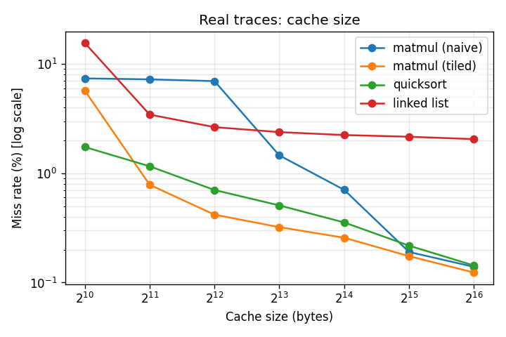
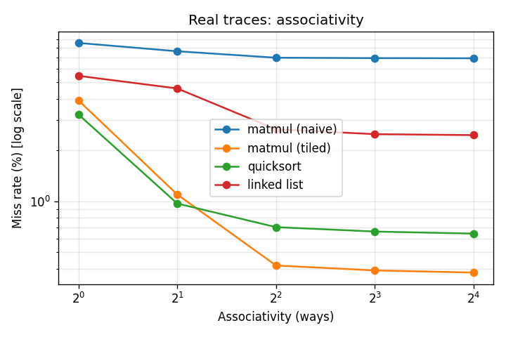
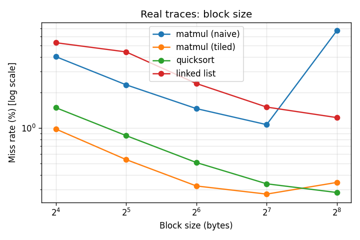

# Cache Simulator with Performance Analysis

[](https://github.com/YOUR-USERNAME/cache-simulator/actions)

A configurable CPU cache simulator written in pure Python, with a performance-analysis
suite that sweeps cache parameters and reports miss rate and AMAT (Average Memory
Access Time). It runs on both **synthetic** traces and **real memory traces recorded
from actual programs with Valgrind**.

## Features

- Direct-mapped, N-way set-associative and fully associative caches
- Replacement policies: **LRU, FIFO, Random**
- **Write-back + write-allocate** with dirty-bit tracking and write-back counting
- Compulsory-miss detection
- Metrics: hit/miss rate, write-backs, **AMAT = hit time + miss rate x miss penalty**
- Trace generators: sequential, loop, random, matrix (row/column-major)
- Trace loader for **Valgrind lackey**, **Dinero (.din)** and **CS:APP Cache Lab** formats (`.gz` supported)
- Experiments for cache size, associativity, block size, replacement policy; plots via matplotlib
- Unit tests and GitHub Actions CI

## Quick start

```bash
git clone https://github.com/YOUR-USERNAME/cache-simulator.git
cd cache-simulator
pip install -r requirements.txt

python cache_sim.py                         # demo on synthetic traces
python real_traces.py traces/matmul.trace.gz   # simulate one real trace
python experiments.py                       # synthetic analysis  -> results/
python experiments_real.py                  # real-trace analysis -> results/ (~2-3 min)
python -m pytest tests                      # run the tests
```

Requires Python 3.9+.

### Using the simulator in your own code

```python
from cache_sim import Cache, run_trace
from real_traces import load_trace

cache = Cache(cache_size=8192, block_size=64, associativity=4, policy="LRU",
              hit_time=1, miss_penalty=100)
run_trace(cache, load_trace("traces/qsort_prog.trace.gz"))   # or your own trace
cache.report("My experiment")
```

## How it works

An address is split into three fields:

```
| TAG | INDEX | OFFSET |
```

`offset` = byte within a block, `index` = which set the block maps to, `tag` = identifies
the block stored in that set. A lookup compares the tag against every way of the indexed
set: match = **hit**, otherwise **miss** (fetch the block, and if the set is full, evict a
victim chosen by the replacement policy; dirty victims are written back).

## Traces

| File | Source | Description |
|---|---|---|
| `traces/matmul.trace.gz` | Valgrind lackey | 48x48 matrix multiply, naive triple loop |
| `traces/matmul_tiled.trace.gz` | Valgrind lackey | Same multiply with 8x8 tiling |
| `traces/qsort_prog.trace.gz` | Valgrind lackey | `qsort` of 6000 random ints |
| `traces/linkedlist.trace.gz` | Valgrind lackey | Build and walk a 4000-node linked list x5 |

The C source for each program is next to its trace. Only **data** accesses (loads/stores)
are used. To record your own trace (Linux/WSL, `sudo apt install valgrind gcc`):

```bash
cp myprog.c traces/ && ./make_traces.sh myprog     # -> traces/myprog.trace.gz
```

Traces from other tools work if converted to Dinero (`<0|1|2> <hex address>`) or lackey format.

## Results (real traces)

Miss rate (%), 64-byte blocks, 4-way, LRU unless noted. Full output in `results/real_results.txt`.

| Cache size | naive matmul | tiled matmul | quicksort | linked list |
|---|---|---|---|---|
| 1 KB | 7.39 | 5.72 | 1.74 | 15.61 |
| 4 KB | 6.98 | 0.42 | 0.70 | 2.65 |
| 8 KB | 1.46 | 0.32 | 0.51 | 2.38 |
| 64 KB | 0.14 | 0.12 | 0.14 | 2.06 |

AMAT at 4 KB: naive matmul **7.98** cycles vs tiled **1.42**, quicksort 1.70, linked list 3.65.





### Key findings

1. **Tiling cuts the miss rate from 6.98% to 0.42%** (4 KB cache) with identical arithmetic: AMAT improves ~5.6x purely from software access order.
2. **Working-set knees:** each program's miss rate drops sharply once the cache holds its working set (naive matmul at 8 KB, tiled at 2 KB).
3. **Pointer-chasing has a miss floor (~2%)** that more capacity cannot remove: scattered nodes lack spatial locality.
4. **Associativity gains flatten beyond ~4 ways**, consistent with real L1 designs.
5. **Block size has a workload-dependent sweet spot:** naive matmul is best at 128 B and degrades sharply at 256 B (too few blocks in 8 KB).
6. **LRU <= FIFO <= Random in miss rate**, with a modest gap.

Synthetic-trace results are in `results/synthetic_results.txt` (miss rates are much higher because
the synthetic workload is deliberately harsh; trends match).

## Project structure

```
cache_sim.py          # Cache class + synthetic trace generators + demo
real_traces.py        # loader for lackey / Dinero / CS:APP traces
experiments.py        # parameter sweeps on synthetic traces
experiments_real.py   # parameter sweeps on real traces
make_traces.sh        # record a new trace with Valgrind
traces/               # real traces (.trace.gz) + C source
results/              # plots and result tables
tests/test_cache.py   # unit tests
```

## Limitations

- Single-level data cache (no L2/L3, prefetching, multicore or virtual memory)
- Fixed hit time (1) and miss penalty (100 cycles); real hit time grows with cache size
- Real traces come from small `-O0` toy programs and include program-startup accesses (dynamic loader, libc); use SPEC/PARSEC-class traces for research-grade numbers
- Pure Python: ~1.5 s per million accesses

## Possible extensions

L2 cache, 3C miss classification (capacity vs conflict), write-through/no-allocate option, prefetcher, larger benchmark traces, Streamlit GUI.

## License

MIT, see `LICENSE`.
